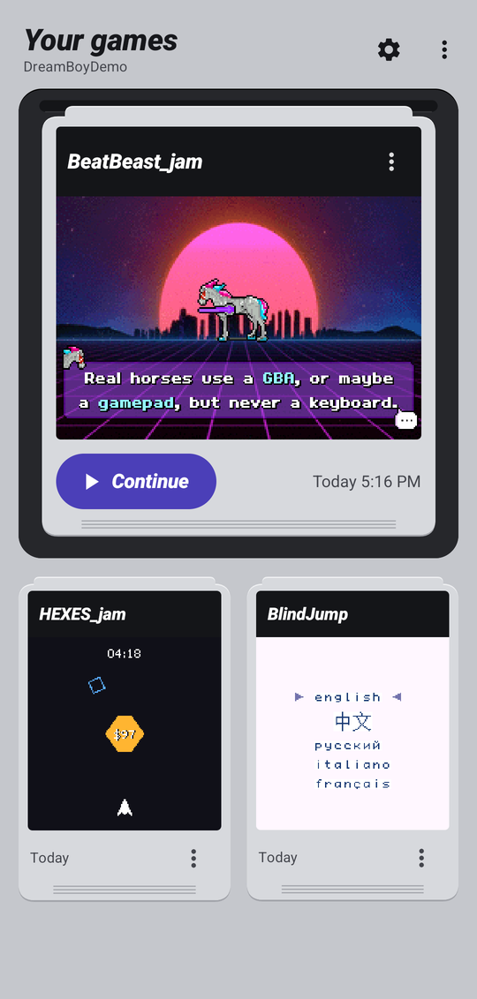
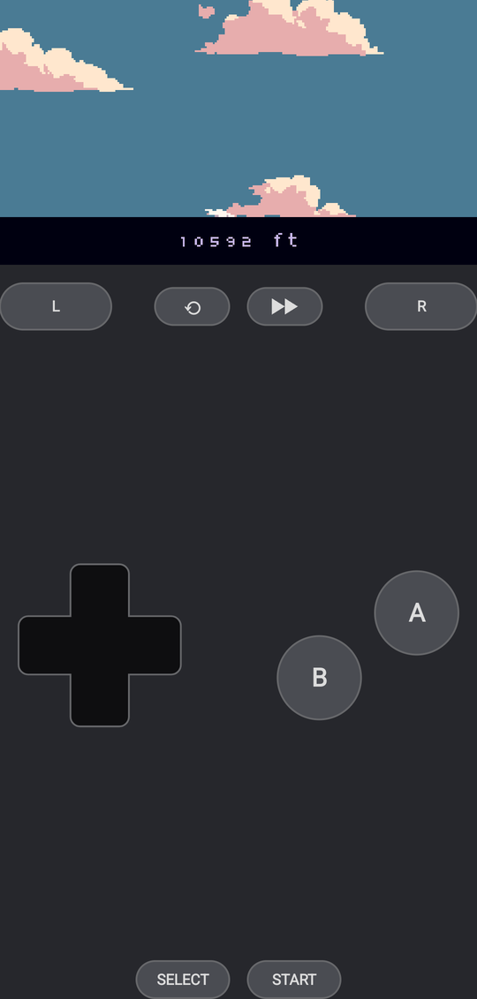
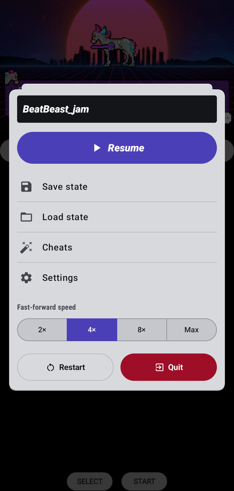
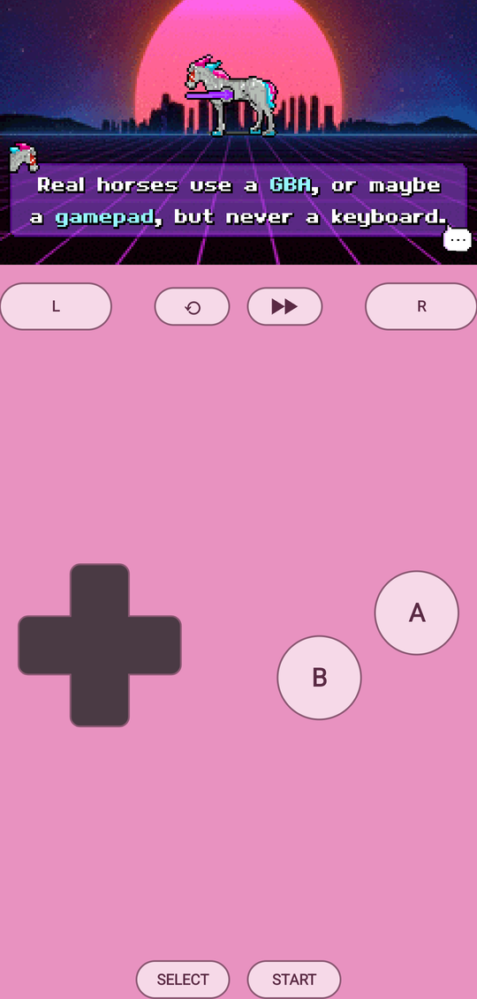

# DreamBoy

**A fast, free Game Boy, Game Boy Color and Game Boy Advance emulator for Android.**

| Your games | Playing | Pause menu | Console skins |
|---|---|---|---|
|  |  |  |  |

DreamBoy's emulator cores are its own, written in C (the Game Boy Advance one with hand-written ARM64 assembly), so it
runs games at full speed on cheap and old phones. It's free and open source (GPL-3.0), with no ads, no tracking and no
account needed.

## Features

For every game (`.gba`, `.gb`, `.gbc`, or one of them in a `.zip`):

- Save states (10 slots and a quick slot), rewind and fast-forward
- Touch controls with a layout editor, 13 console skins, keyboards and gamepads
- In-game saves in the usual `.sav` format, and the real-time clock of cartridges that have one
- Box art for your game list, and backup and restore of everything as one `.zip`

For Game Boy Advance games today, for Game Boy and Game Boy Color games in a later version:

- Cheats: Action Replay, GameShark, CodeBreaker, raw codes and libretro `.cht` files
- [RetroAchievements](https://retroachievements.org): achievements and leaderboards (sign in with your own account)
- Imported Delta skins (`.deltaskin`)
- Tilt, gyro, solar sensor and rumble cartridges

Game Boy Advance games use a built-in BIOS (your own BIOS file is optional); Game Boy games need none.

**No games or BIOS come with the app.** Use games you own.

## Install

1. Download `DreamBoy-<version>.apk` from the [latest release](https://github.com/tengencode/DreamBoy/releases/latest)
   on your phone.
2. Open it. If Android asks, allow your browser or files app to install apps.
3. Open DreamBoy and choose the folder where your games are.

DreamBoy needs Android 8 or newer. To get new versions automatically, add this page to
[Obtainium](https://github.com/ImranR98/Obtainium).

## RetroAchievements

Sign in under Settings → RetroAchievements with your own retroachievements.org account. Achievements unlock and
leaderboards can be viewed in Game Boy Advance games. Hardcore mode, and with it sending leaderboard scores, waits until
RetroAchievements approves DreamBoy, which they consider once an emulator has been public for six months.

## How it was made

DreamBoy was built with a lot of help from an AI assistant (Claude); every commit says so. Its correctness rests on
tests rather than trust: hundreds of unit tests, public CPU, graphics and sound test ROMs for all three consoles, frame
and sound fingerprints, the mGBA test suite, on-device tests, and a check that plays dozens of games by script. Bug
reports are welcome.

## Building

See [docs/BUILDING.md](docs/BUILDING.md). Releasing: [docs/RELEASE.md](docs/RELEASE.md).

## Licence and privacy

GPL-3.0-or-later: see [LICENSE](LICENSE). Third-party code is listed in [third_party/README.md](third_party/README.md)
(rcheevos, MIT); the app lists every part it is built from under Settings → About DreamBoy. What the app does with your
data: [PRIVACY.md](PRIVACY.md).

The screenshots show free homebrew games: Blind Jump by Evan Bowman (MIT), Beat Beast by afska (MIT) and HEXES by
Eigenlight Arts (MIT).

Game Boy, Game Boy Color and Game Boy Advance are trademarks of Nintendo. This project is not affiliated with or endorsed
by Nintendo.
